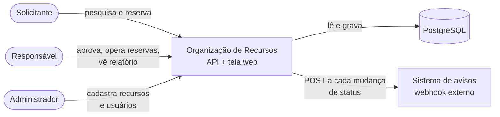
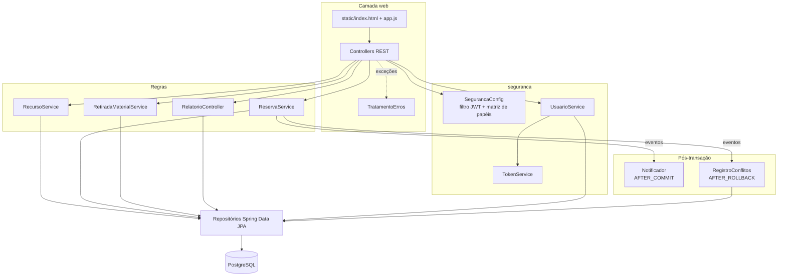
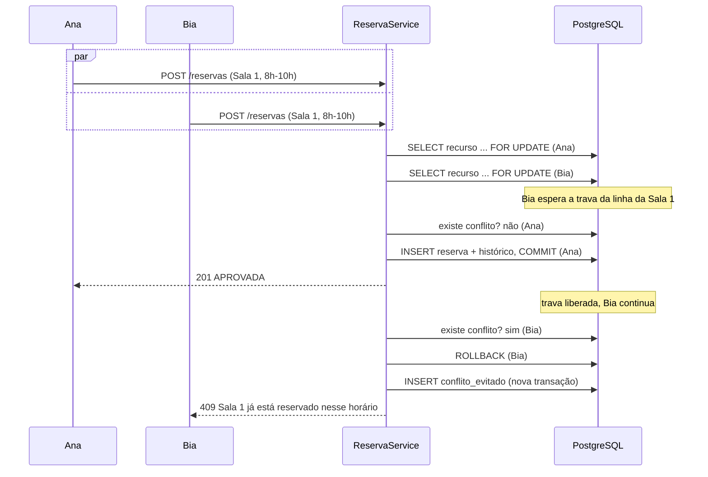
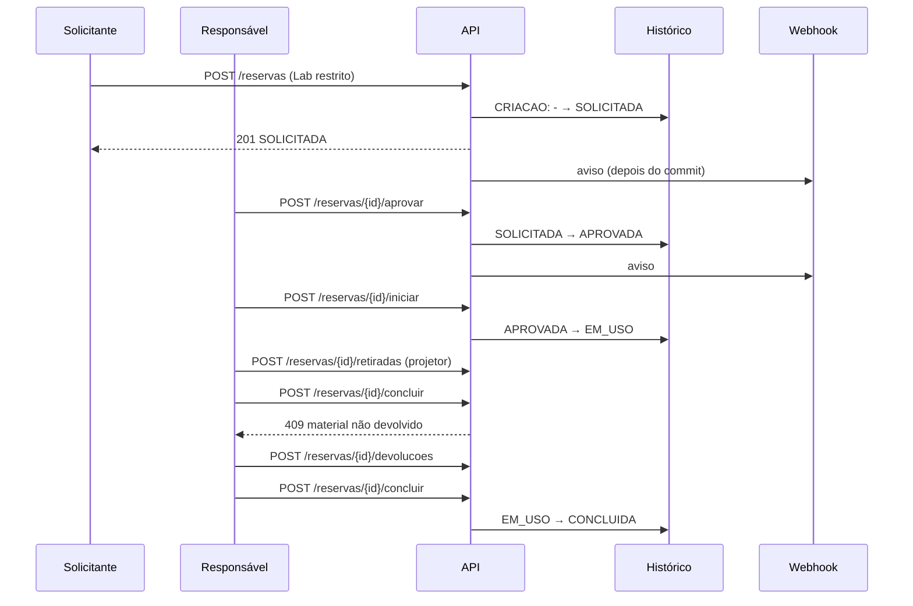

# Arquitetura

API REST em Spring Boot 3.5 (Java 21) com PostgreSQL 16. Uma aplicação só, organizada por assunto (cada pacote tem entidade, repositório, serviço e controller do seu tema).

## Diagrama de contexto

## Diagrama de componentes

| Pacote | Responsabilidade |
|---|---|
| `seguranca` | Usuários, login, geração e validação do token, matriz de autorização por papel |
| `recurso` | Cadastro e pesquisa de salas, professores e materiais |
| `reserva` | Criação, alteração, máquina de estados, checagem de conflito, histórico e conflitos evitados |
| `material` | Retirada e devolução de materiais de uma reserva |
| `notificacao` | Aviso por webhook depois que a mudança foi gravada |
| `relatorio` | Uso por recurso |
| `comum` | Erros de negócio e formato padrão das respostas de erro |

## Sequência crítica 1: duas pessoas reservam o mesmo horário ao mesmo tempo

## Sequência crítica 2: reserva de recurso restrito até a conclusão

## Decisões

### D1. Trava pessimista na linha do recurso para evitar reserva dupla

Opções consideradas:
- Checar conflito e inserir sem trava: duas transações leem "livre" ao mesmo tempo e as duas gravam.
- Restrição de exclusão no PostgreSQL (`EXCLUDE USING gist`): forte, mas a reserva aponta para vários recursos por tabela de ligação e a regra de status (só ativas contam) complica a restrição.
- `SELECT ... FOR UPDATE` nos recursos pedidos, em ordem de id, antes de checar e gravar.

Escolhida a terceira. É simples de explicar, vale para sala, professor e material do mesmo jeito, e a ordem por id evita deadlock quando duas reservas pedem os mesmos recursos em ordem diferente. Custo: pedidos para o mesmo recurso viram fila. Pedidos para recursos diferentes não esperam.

Evidência: `ConcorrenciaTest` (10 pedidos simultâneos, 1 reserva) e o teste de carga.

### D2. Conflito evitado gravado depois que a transação da reserva termina

O pedido recusado sofre rollback, então gravar o conflito na mesma transação perderia o registro.

A primeira versão gravava num listener `AFTER_ROLLBACK` com transação nova. O teste de carga mostrou que isso estava errado ([DEF-03](defeitos/DEF-03.md)): nessa fase a conexão da transação original ainda não voltou ao pool, então cada pedido recusado precisava de duas conexões. Com 50 usuários, as 10 conexões ficavam presas esperando uma 11ª e as requisições caíam por timeout.

Versão atual: `criar` e `alterar` usam `TransactionTemplate`. A exceção de conflito (`ConflitoDeAgenda`) atravessa o fim da transação, a conexão é devolvida e só então o conflito é gravado, com uma conexão de cada vez. A tabela guarda só o id do recurso, sem chave estrangeira.

### D3. Auditoria na mesma transação; aviso externo depois do commit

O histórico é parte da regra (toda mudança precisa de registro), então grava junto: se falhar, a mudança é desfeita (`AuditoriaAtomicaTest`). O webhook é efeito colateral: roda depois do commit, com timeout de 2 s, e se falhar fica só um aviso no log (`NotificacaoTest`).

### D4. Um único modelo de recurso

Sala, professor e material são a mesma entidade com um campo `tipo`. Assim a checagem de sobreposição, a manutenção e o "restrito" valem para os três sem código repetido. Campos que não se aplicam ficam nulos.

### D5. Token JWT com o suporte nativo do Spring Security

Usado o resource server do Spring Security com chave HMAC, em vez de filtro próprio. Menos código de segurança escrito à mão. A matriz de papéis fica num lugar só (`SegurancaConfig`); a regra "só o dono" fica no serviço, porque depende do dado.

## Limitações conhecidas

- Tabelas criadas pelo Hibernate (`ddl-auto=update`). Para produção, trocar por migrações versionadas.
- Pesquisa de recursos e relatório agregam em memória. Bom para o volume de uma escola; para muitos milhares de registros, mover para consultas no banco.
- O webhook é chamado de forma síncrona após o commit. Um webhook lento atrasa a resposta em até 2 s.
- Não há fuso horário: datas são `LocalDateTime`, assumindo que todos usam o mesmo fuso da escola.
